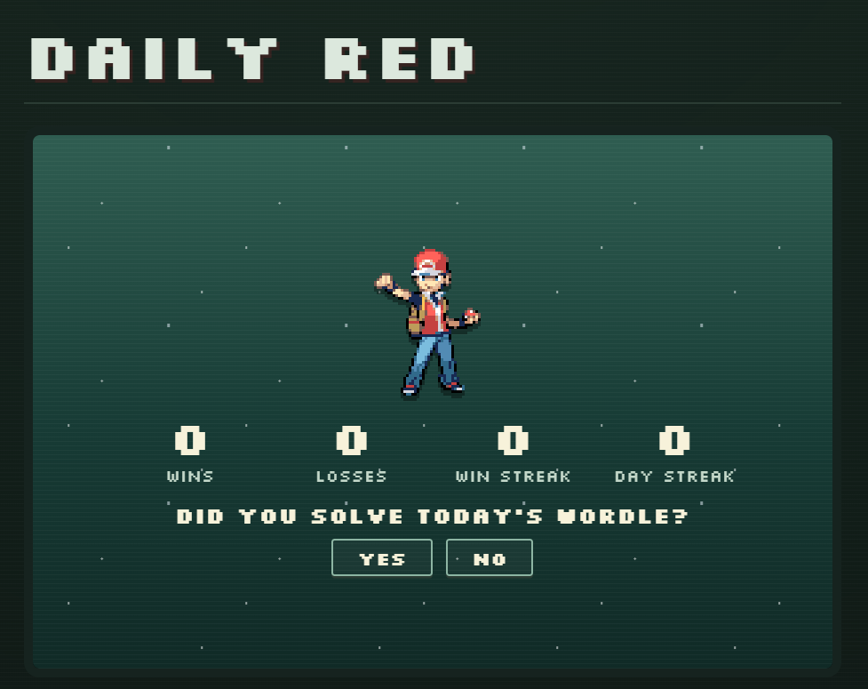
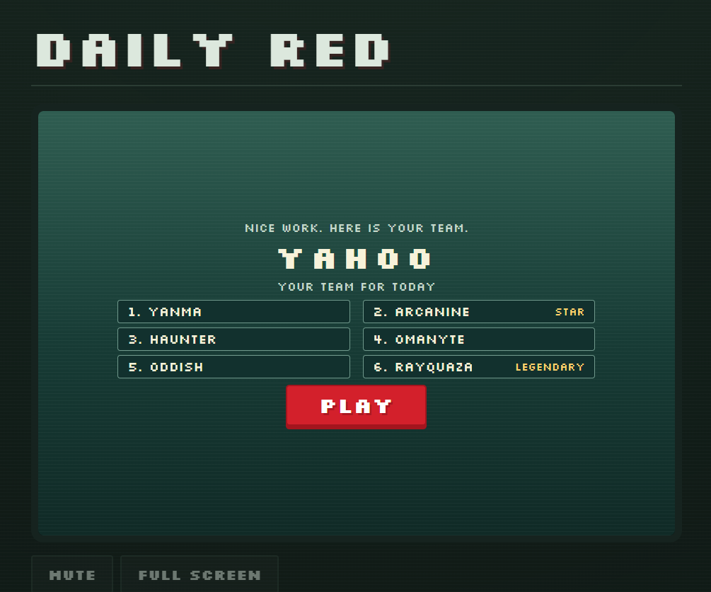
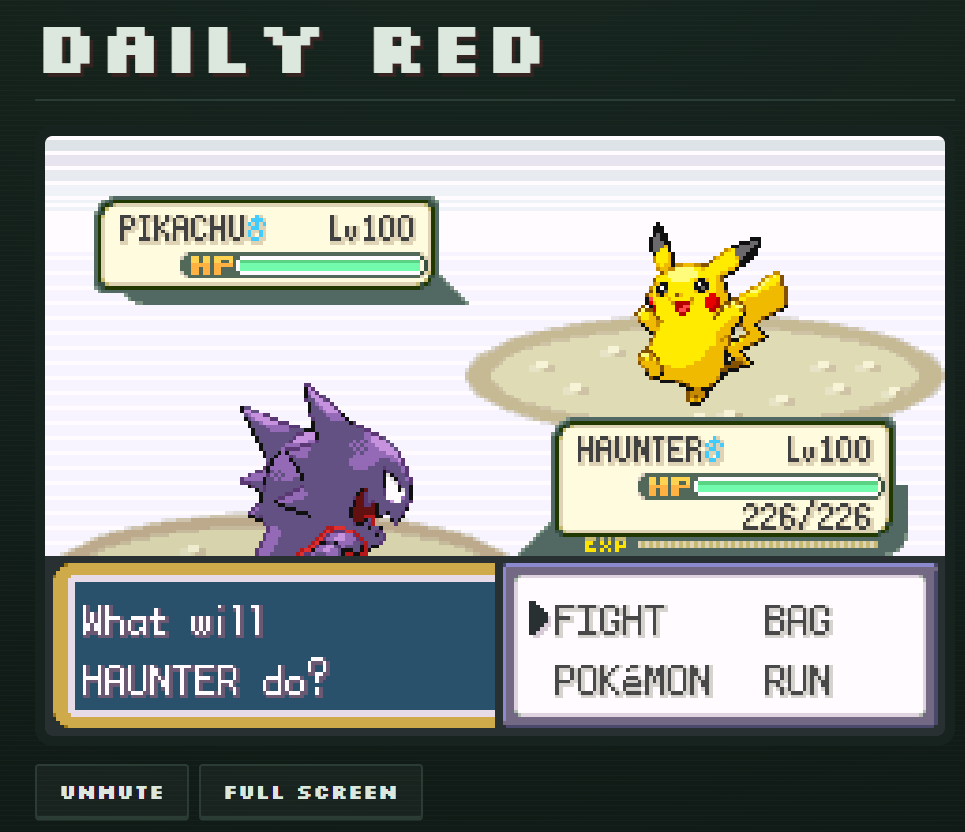

When I shared Daily Red on Twitter, I thought maybe eight or ten people would try it. If it got 200 page views, that would have been a good result.

By the next day, it had 2,500 visitors.

It had also crossed my Vercel limits.

The game worked. The way I was delivering it needed some attention.

Today, Daily Red has had around 50,000 visitors and 100,000 page views. Somewhere between those first few players and now, I ended up learning quite a bit about browser caching, WebAssembly downloads, and what actually needs to happen on a server.

  

## But first, the game.

Daily Red is a daily Pokémon battle against Red. You get six Pokémon, walk up a mountain, and try to beat him. One official attempt per day.
Your team comes from that day's Wordle answer.


  

The first five Pokémon match the five letters of the word. If the answer were YODEL, the team could include Yanma, Octillery, Donphan, Exeggcute, and Lapras. The sixth slot is a legendary.

There's some logic behind the selection, because picking five Pokémon by their initials can give you a pretty miserable team. The algorithm tries to get the combined base stat total to at least 2,700, avoids repeated species where possible, and reserves a slot for a strong "star" Pokémon that can help carry the team.

I also wanted variety. Always choosing the strongest possible Pokémon for every letter would make some letters very predictable.

The randomness is seeded, so everyone playing the same day's challenge gets the same team. The moves and held items are fixed too. You can't refresh until you get something better.

That part mattered to me. People should be able to compare their attempts knowing they had the same tools.

Underneath the website, this is actual FireRed gameplay, built from the community's [pret/pokefirered project](https://github.com/pret/pokefirered). The browser runs it through an emulator powered by WebAssembly. The website handles the daily reveal, starts the game, and keeps your record in your browser.

### That also explains where the bandwidth went.

A normal page might download some HTML, styles, images, and JavaScript. Daily Red also needs the game ROM and the emulator engine.

The compressed ROM was about 5.47 MB. The emulator's WASM file was another 3.17 MB. Those two files alone added up to roughly 8.6 MB per fresh download, before the rest of the site.  

The original setup served the site through a Node server running in a Vercel container function. That included the big game files. The responses also used `no-cache`, so I wasn't giving browsers a clear instruction to keep those unchanged assets and reuse them without checking back.

I considered moving to Cloudflare. But I was happy to pay for Vercel if I could first make the app less wasteful.
The biggest change was separating the build process from serving the game.
Compiling FireRed needs a proper toolchain. 

I moved the build into GitHub Actions, using Docker to keep the compilation environment consistent. The pipeline now builds the game, packages the site, runs checks, and sends prebuilt output to Vercel. 

Vercel serves the ROM and emulator files directly through its CDN. They no longer need to pass through the Node function.
There is still a small function for fetching the dated Wordle answer. The actual battle runs on the player's device.
Then I fixed how the large files were cached.

The ROM and emulator assets now have URLs based on a hash of their contents. If a file stays the same, its URL stays the same. If the file changes, it gets a new URL.

```js
const sha256 = (bytes) =>
  createHash('sha256').update(bytes).digest('hex');

const compress = path.endsWith('.wasm');
const bytes = compress
  ? gzipSync(inputs.get(path), { level: 9 })
  : inputs.get(path);

const hash = sha256(bytes);
const url = `/_vercel/immutable/${hash}/${basename(path)}${compress ? '.gz' : ''}`;
```

That lets me give those files a one-year cache lifetime with `immutable`. A returning player can reuse the copy their browser already downloaded. The small application files still revalidate so people receive updates. 

```js
// Content-addressed game assets: keep for a year.
headers: {
  'Cache-Control': 'public, max-age=31536000, immutable'
}

// HTML and small application files: check for updates before reusing.
headers: {
  'Cache-Control': 'public, max-age=0, must-revalidate'
}
```

A useful detail here is that a new daily team doesn't require a new ROM. The website injects the day's configuration into the game locally before starting it. 

Tomorrow's Pokémon can be different while the downloaded game file stays exactly the same. 

I also compressed the WASM file before shipping it. That brought it down from about 3.17 MB to 1.10 MB. Together, the ROM and WASM download went from roughly 8.6 MB to 6.6 MB, about a 24% reduction. 

```js
const patched = rom.slice();
const view = new DataView(patched.buffer);

view.setUint32(offset, seed >>> 0, true);
for (let i = 0; i < 6; i++) {
  view.setUint16(offset + 16 + i * 2, daily && species ? species[i] : 0, true);
}
```

The browser decompresses them before handing them to the emulator. The game downloads also wait until someone presses Play. Opening the page to look at the reveal shouldn't immediately trigger the whole emulator download.

Browser caches can still be cleared or evicted. A new visitor still needs the files. But a returning player shouldn't have to download the whole engine again just because they've come back for tomorrow's battle.

### There were gameplay fixes along the way too. 

Random legal movesets turned out to be a fairly good way to make a team frustrating. I worked on choosing more useful attacks and matching items to the Pokémon's build.

Players also noticed things I hadn't, including digits in the original font that were difficult to read. Once people are actually using something, the list of things worth fixing gets very specific.

**Daily Red is now at around 50,000 visitors and 100,000 page views.**

#### I'm glad people kept showing up.

### I'm still pretty bad at it though :P 


