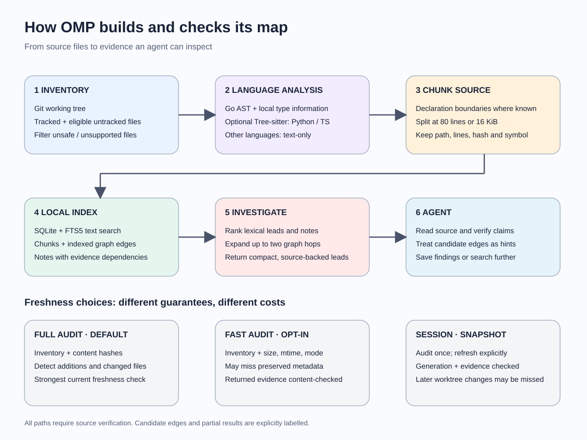

When you join a large codebase, the hard part often isn't reading a function. It's finding the right function, figuring out what calls it, and understanding how its behavior crosses module or language boundaries.

Coding agents go through the same process. They search, read, search again, and piece together an answer. OnboardMePlease (OMP) is built to make that investigation easier: it indexes a repository into searchable source chunks and relationships, so an agent can find leads, follow connections, and save findings backed by code.

## How the project evolved

OMP started as a GitHub repository analyser: it captured a commit, stored source in PostgreSQL, and offered search and graph navigation through an API and UI. That helped explore the problem, but it also required a service, database, and background jobs.

The current version is a local Go CLI backed by SQLite. It works with a Git working tree and gives coding agents a map to explore. OMP doesn't run a model or write the final answer; the agent inspects the evidence and explains what it finds.

## Why chunk and index the code?

A whole repository is too much context for a question, and a single matching line often leaves out the surrounding logic. Chunks provide a useful middle ground: small pieces of source that can be searched, cited, and checked for changes.

OMP uses declaration boundaries for Go and, with an optional Tree-sitter adapter, Python and TypeScript/TSX. Other languages fall back to bounded line chunks. Large declarations are split into pieces of at most **80 lines or 16 KiB**.

Each chunk keeps its source path, line range, file hash, text, and symbol when available. Its evidence ID includes the file hash and range, tying it to a particular version of the source.

The chunks live in a local SQLite index. FTS5 makes their text searchable, including code identifiers split from forms such as `camelCase` and `snake_case`. The database also stores relationships and saved findings. OMP uses lexical search rather than embeddings, which keeps the setup simple but means it can miss questions phrased differently from the code.

## Connecting the pieces

Finding a function is only the start. OMP also records relationships such as calls, references, imports, and source-order continuations. In Go, it uses parser and type information to connect local declarations. That gives it a stronger basis than matching names alone, although dynamic dispatch and missing dependencies still leave gaps.

Python and TypeScript support is syntax-based: their call links are **candidates**, not compiler-resolved relationships. OMP can also suggest some cross-language connections, such as a TypeScript `fetch` matching a Go route. Those are leads to inspect, not proof that a request reaches that handler. Other languages remain searchable as text even when OMP can't resolve their calls.

When an agent runs `omp investigate` with a question, OMP ranks source chunks using words, identifiers, paths, and other lexical signals. It returns a small set of leads and expands the graph around the first result, up to two hops. The agent can then read the source, follow evidence, or fall back to ordinary search. The limits keep results manageable, but they also mean a useful connection can be missed.

## Keeping the map current

A useful map has to reflect the code an agent is reading. During `omp update`, OMP hashes files and reuses unchanged chunks. When the source generation changes, it currently recomputes the relationships; more targeted graph updates are a possible future improvement.

By default, retrieval checks the inventory and content hashes. This catches additions as well as edits, which matters when a new file could introduce a caller that wasn't there before. The check can be expensive in a large repository, so OMP offers two alternatives:

- **`--fast`** checks file metadata such as size and modification time. It can miss changes if that metadata is preserved.
- **`session`** checks once and reuses the result across queries. It checks returned evidence but can miss other changes made after the session audit, so results are labelled as a partial snapshot.

Agents can also save findings with evidence and dependency information. If the supporting code changes, OMP marks the affected claim stale rather than presenting it as current. That checks the evidence's freshness, though the agent still has to judge whether its interpretation is correct.

## What we've learned from testing

On a pre-indexed VS Code repository with **20,691 tracked files**, a scripted three-query investigation averaged **38.08 seconds** using separate `--fast` calls and **15.96 seconds** using a `--fast` session. That's a **58% reduction for that sequence**, including the session's initial audit. It doesn't include index construction or measure an agent's end-to-end speed, and the session uses the weaker snapshot guarantee described above.

The results aren't always in OMP's favor. In one exploratory Kafka agent comparison, direct search took **105.50 seconds** and the OMP-assisted run took **177.65 seconds**. The answers differed in detail, so the gap can't be attributed to OMP alone. The test did expose a limitation: Kafka's Java and Scala files were searchable, but OMP couldn't resolve their cross-file call chains with its available language support.

That is the standard I want to keep testing against. The goal isn't to build the most elaborate graph; it's to help an agent reach a correct, source-backed answer with less work, while accounting for the time it takes to build and maintain the index.

---

Details and benchmark methods are documented in the [architecture](https://github.com/danishjuneja/OnboardMePlease-okf/blob/main/docs/architecture.md) and [evaluation notes](https://github.com/danishjuneja/OnboardMePlease-okf/blob/main/docs/agent-evaluation.md).
